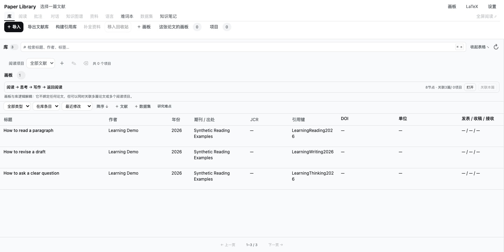
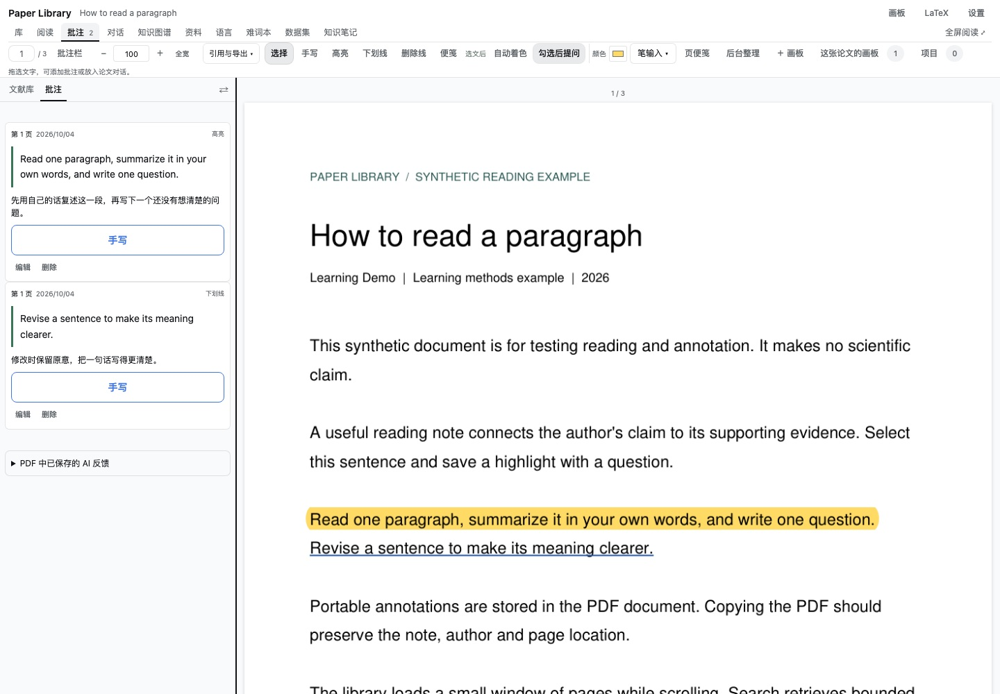
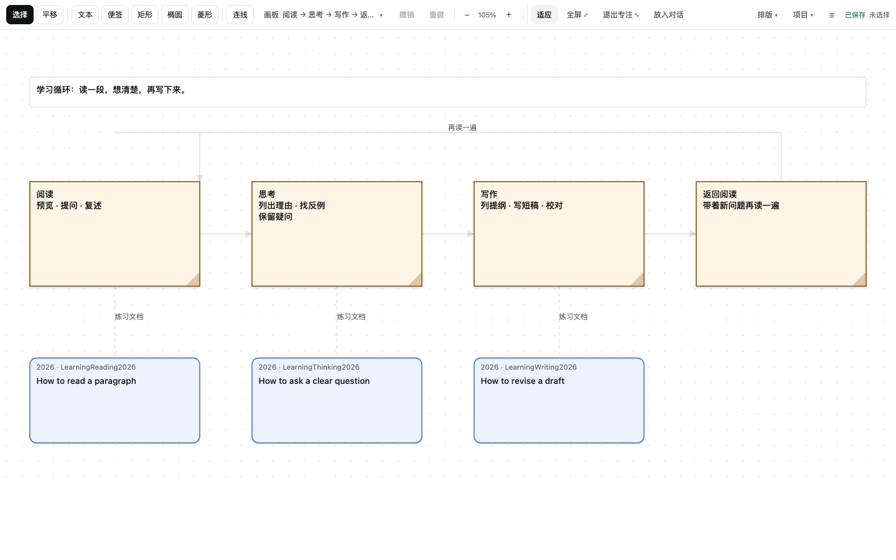
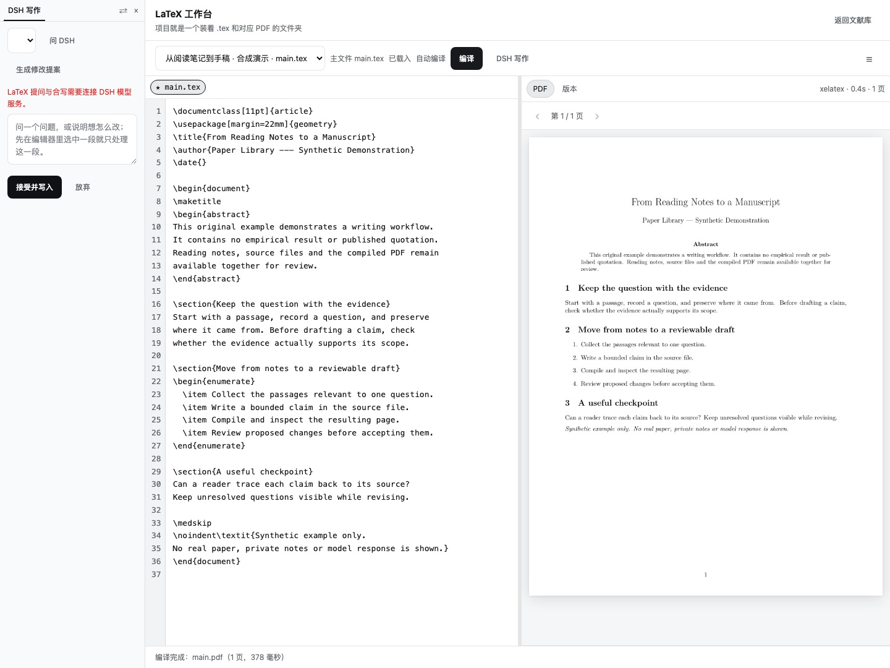

<div align="center">

# Paper Library

**Collect papers, annotate PDFs, organize evidence, and write in DeepSeek Harness.**

[](https://www.npmjs.com/package/@mappedinfo/dsh-paper-library)
[](https://www.npmjs.com/package/@mappedinfo/dsh-paper-library)
[](https://github.com/deepseek-ai/deepseek-harness)
[](https://github.com/deepseek-ai/deepseek-harness/discussions/6623)
[](LICENSE)

[简体中文](README.md) · **English**

[Install](#installation) · [Start reading](#start-with-one-pdf) · [Try the demos](#try-the-demos) · [DSH community](https://github.com/deepseek-ai/deepseek-harness/discussions/6623) · [English introduction](https://github.com/deepseek-ai/deepseek-harness/discussions/6623#discussioncomment-19481436) · [Report an issue](https://github.com/Mappedinfo/dsh-paper-library/issues)

</div>

> Unofficial DSH community plugin, independently developed and maintained by Mappedinfo. Original code is MIT-licensed; the PDF engine and other dependencies have separate licenses. See [Third-party licenses](THIRD_PARTY.md).

Paper Library brings literature management, PDF annotations, AI conversations, knowledge graphs, boards, LaTeX, and slides into one workspace. It runs as a [DeepSeek Harness](https://github.com/deepseek-ai/deepseek-harness) plugin or as a standalone local service. It is an independent application, not a Zotero extension.

Papers and reading records stay in your chosen library on the machine running DSH. In DSH, the plugin uses the host's model services, sessions, and authentication. Model features send the relevant material to the configured provider; local storage does not mean that AI inference runs offline.

| Your task | What you can do |
| --- | --- |
| Collect and organize | Import PDFs and DOI records, review metadata, copy APA 7 citations, use favorites and hierarchical tags |
| Read and ask | Highlight, underline, draw rectangles or freehand strokes, and keep follow-up questions under the same annotation |
| Browse a paper's structure | Jump through formulas, figures, tables, and algorithms; preview crops and pseudocode flowcharts |
| Build knowledge | Translate passages, improve wording, collect bilingual vocabulary, and explore evidence and citation graphs |
| Write and present | Arrange papers on boards, edit and compile LaTeX, and export editable PowerPoint slides through PlainDeck |

**Version scope:** this page describes the current `main` source as of November 9, 2026. npm's published version was `0.2.5` when checked on that date; `main` includes updates not yet released to npm. Use the [source installation](#installation) for the features described here. The badge reports the published package version, not feature parity with `main`.



## Start with one PDF

1. Open Paper Library from DSH and import a PDF, DOI, or public paper URL.
2. Check its title, authors, year, and identifiers. Metadata suggestions remain reviewable; missing information is not invented.
3. Open the PDF and mark a passage. Write a note in the annotation sidebar, or ask DSH directly about the selected text.
4. Add another note or question under the same annotation to continue the discussion. Each note has its own question button.
5. Organize the paper with a reading project, favorite, or tag; take useful evidence to a graph, board, or writing project.

The standalone interface supports local library work. The integrated paper conversation requires DSH. Most detailed guides linked below are currently in Chinese; this page provides the English overview and setup instructions.

## Collect, organize, and cite

- Import PDFs, public paper URLs, DOI and arXiv links, or metadata in JSON, RIS, and BibTeX. Zotero exports can be imported without turning the plugin into a Zotero extension.
- Search metadata and abstracts, edit records in the catalog, and organize papers into multiple reading projects. Search currently does **not** index the full PDF text.
- Favorite papers and add manual tags such as `#methods/deep-learning/transformers`. A parent tag includes its descendants. Favorites and manual tags are stored separately from imported tags so synchronization does not overwrite them.
- Request metadata suggestions from public sources such as Crossref and arXiv. Review the resulting fields before saving. Unknown authors, dates, affiliations, and identifiers remain unknown.
- Copy APA 7 citations as rich or plain text, export BibLaTeX, and check citation keys and DOI conflicts. APA formatting uses CSL and citeproc, rather than handwritten citation rules.

Optional external sources can expose an existing PDF directory for reading; a managed copy is created when needed for annotation. Live Zotero databases and imported originals are not edited.

## Read and annotate the PDF itself

The reader supports continuous scrolling, single- and double-page layouts, zoom, fullscreen, and adjustable sidebars. Existing PDF citation links can jump to reference entries; **Return to previous position** restores the earlier location, zoom, and layout. Missing internal links are not guessed.

Highlights, underlines, strikeouts, notes, rectangles, and freehand ink are stored as **standard PDF annotations in the managed copy**. They travel with the exported PDF and can be recovered from it without private catalog annotation rows. External annotations are preserved. Writes use a backup and atomic replacement after successful serialization.

Annotation notes are edited and saved in the sidebar. Add **Note / follow-up** to keep note 1, note 2, and their AI replies under the same marked passage. AI replies are labeled separately, show a short expanded preview, and can be copied or quoted in another question. Selecting several annotations sends one combined question; it does not duplicate the answer across every selected annotation.

Rectangle annotations help discuss a detail in an image. Drag and release to save the transparent rectangle, then add a note in the sidebar. A lazy-loaded crop shows the selected PDF region. Linked handwriting keeps ink near the original passage and retains its PDF position.

**Reading display** offers dark PDF rendering and English bionic reading. These affect the display, not the source file or copied text. Dark rendering also changes figure colors; switch it off to inspect the original colors. Bionic reading needs a usable text layer.



Handwriting was developed for an Apple Pencil / Sidecar reading workflow, with browser checks primarily in Chrome. Physical Pencil / Sidecar, Safari, and Electron still need device validation. Pressure sensitivity and Pencil double-tap or squeeze controls are not implemented. [Detailed annotation guide (Chinese)](README.md#pencil-文字标注与关联手写)

## Ask DSH while reading

When an annotation does not provide enough context, DSH can search the current PDF with `library_paper_search` and read relevant pages with `library_paper_read` before answering. The guidance requires checking the paper's own methods separately from background work and citing the physical PDF pages actually read. Existing replies are preserved; ask a follow-up to revisit them.

These read-only tools do not build an index, render images, or start full-paper analysis. Search scans at most 20 pages per call; reading returns at most three pages and 4,000 characters per page, with continuation for long pages. The prompt suggests a typical six-call / 24,000-character budget; this is guidance, while per-call limits are enforced. Missing text layers and read failures remain visible. The integration makes retrieval available but does not guarantee a model's interpretation.

Each paper has its own DSH conversation, shared between the plugin and the DSH main view. You can ask about a marked passage without first writing a question, write a specific question in a note, or select several annotations as material for one request. The separate **Put into main input** action prepares a draft rather than sending it.

Optional live reading assistance queues responses to annotation events. Saving a sidebar note alone does not call a model. Relevant sources are captured before sending so later PDF edits do not silently change an earlier request. The main DSH conversation handles model selection, tool permissions, complete history, and stopping a response.

AI responses remain distinguishable from the reader's own notes. They are reading aids to review against the paper, not verified evidence merely because they have been saved.

## Formulas, figures, tables, and algorithms

The reading sidebar has separate **Formulas**, **Figures**, **Tables**, and **Algorithms** views. Open a view to scan the current PDF in small page batches, search the results, and jump back to the source page.

| View | Extracted material |
| --- | --- |
| Formulas | Formula regions, explicit equation numbers, and nearby definitions copied from the source |
| Figures | Embedded images and captioned vector figures, region previews, and flowchart candidates identified from captions |
| Tables | Detected table regions and cells, including orientation-aware crops for rotated tables |
| Algorithms | Captioned pseudocode and flowcharts built from explicit loops, branches, and return statements |

These extraction paths use the local PDF engine and deterministic rules, without an LLM. A completed scan means the pages were visited, not that every object was recognized correctly. Complex layouts, unnumbered formulas, scanned pages without a text layer, and incomplete pseudocode may need manual inspection. Full-document OCR is not included.

The index is derived data. Extracting it does not write PDF annotations; explicit region-marking actions do. Normal annotation edits do not invalidate the document's text identity and restart analysis. [Structure-reading API (Chinese)](docs/api.md#pdf-结构阅读目录)

## Evidence graphs and real citation relationships

**Analyze full paper** reads the current paper in page batches using an editable question protocol. Saved judgments retain their source text, known page numbers, and review state. In **Full-text judgments**, browse by question, then judgment, then evidence and relationships. This progressively loads the complete saved result instead of treating a limited overview drawing as the full graph. Failed or unsupported judgments remain inspectable without becoming asserted facts.

Opening the library graph from a paper highlights that paper's nodes and relationships and dims the surrounding context. **Paper citations** shows directed citation relationships between paper nodes. Local reference extraction handles supported numbered and author–year bibliographies without an LLM, retaining the original entry and page. Exact DOI matches can connect to papers already in the library; unmatched references remain explicit reference nodes. Shared authors or tags do not become citation edges, and uncertain or truncated entries are not completed by guessing.

Headless analysis is also available for explicitly configured GLM, Kimi, or DeepSeek backends, with bounded requests and concurrency. It produces reviewable results in the same library. See the [headless guide](docs/headless-analysis.md), [question protocol](docs/reading-questions.md), and [Research Knowledge OS export scope](docs/research-os-compatibility.md).

## Language and entries

**Language & Entries** combines translation, writing support, reading history, and bilingual vocabulary. Keep it in a large window or dock it beside the PDF while selecting text. The translation control shows the effective target language, including when it follows a saved preference or automatic detection.

Writing support offers five directions: **grammar**, **conciseness**, **academic wording**, **logical flow**, and **plain-language explanation**. The prompts preserve meaning, numbers, and the strength of the original claims. Translation and vocabulary records retain the source sentence, its translation, and the associated paper. AI definitions remain marked as such and can be edited.

The shared wiki-style browser supports encyclopedia entries, aliases, links between entries, and sorting by date or alphabet. Author background is recorded only when supported or explicitly supplied; it is not inferred from a name.

## Boards, datasets, and writing

### Literature boards

Arrange papers, notes, shapes, and relationships on a board, link several papers or reading projects, and return to a PDF from its paper node. Boards support layout tools, undo/redo, a supported Mermaid subset, draw.io interchange, and readable JSON. AI-proposed changes remain proposals until reviewed.



You can try the [standalone board](https://mappedinfo.github.io/dsh-paper-library/) without installing DSH. It does not connect to a paper library or DSH model. Export JSON for a durable copy of your work. [Board and flow-workspace details (Chinese)](README.md#文献画板)

### Datasets and knowledge records

Register datasets, versions, local files, and citation information; connect a dataset to papers that mention, use, or publish it. Bounded previews of local tabular data help inspect fields and samples. Knowledge notes and relationship drafts retain their source and review status.

### LaTeX workbench

Edit source beside the compiled PDF, inspect compilation errors and version differences, and navigate between PDF and source. Ask DSH about selected source or request an edit proposal; review the proposed replacements before applying them. Revision checks protect against overwriting another window's changes. Compilation requires a local TeX installation and `latexmk`.



[LaTeX self-review guide (Chinese)](docs/latex-self-review.md)

### PlainDeck slides

Build slides with text, images, native tables, cards, and themes. Present them and export editable PPTX, HTML, or a project ZIP, or print to PDF. DSH tools can locate and export saved projects.

The PPTX export includes editable objects, entrance animations, and camera-style zoom effects. Playback of a synthetic deck was confirmed in PowerPoint; WPS playback has not been accepted. PlainDeck ZIP projects can be reimported. **PPTX import is not supported.** [Slides workbench guide (Chinese)](docs/slides-workbench.md)

## Settings, resources, and storage

Choose jade/copper, navy/slate, neutral graphite, soft pink, warm apricot, or the DSH theme. Function colors distinguish reading, knowledge, writing, and presentation actions. The interface follows the host's light/dark mode; PDF display has its own controls.

Reading preferences are shared with the Paper Library section of DSH settings and apply without restarting. Local state uses three-way merging for non-conflicting changes. Conflicting edits retain the draft and ask for review rather than silently concatenating or discarding text.

Background work yields to reading and saving. Structure scans wait for idle reading time, save progress by page, and stop scheduling the next batch when their view is no longer active. The Python PDF worker runs on demand. There is no always-on embedding model or automatic preprocessing of every PDF in an existing library.

| Resource preset | Processing memory target | Preview cache | Main pages per batch / minimum interval |
| --- | --- | --- | --- |
| Economy | 256 MiB | 16 MiB | 1 / 2 s |
| Balanced (default) | 512 MiB | 48 MiB | 2 / 1 s |
| Performance | 1024 MiB | 96 MiB | 4 / 0.5 s |

Custom settings also control disk index budgets and free-space reserves. These are workload and cache targets, **not a hard memory cap on all of DSH or the browser**. Budget or disk-space pauses display a reason and retain completed work so you can adjust settings and continue. Deleting a derived index does not delete the PDF or its annotations.

Managed PDFs, credentials, local settings, and private catalogs are not part of this public repository. See [API and configuration](docs/api.md) and [validation scope](docs/validation.md) for implementation details and measurement boundaries.

## Try the demos

The usage guide itself is a practice document. Import it, annotate it, or open the slide project and export your own version.

| Download | Use |
| --- | --- |
| [PDF guide](docs/demo/guide.pdf) | Eight-page practice manual |
| [Annotated PDF guide](docs/demo/guide-annotated.pdf) | Inspect portable PDF annotations |
| [Editable animated PPTX](docs/demo/slides.pptx) | Ten-slide PowerPoint demo |
| [PlainDeck project ZIP](docs/demo/slides.zip) | Reopen and edit the slide project |
| [Static slide PDF](docs/demo/slides.pdf) | Read the deck without presentation software |

The downloadable guide and slides are currently in Chinese. Screenshots use synthetic documents and generic learning exercises; their UI corresponds to the versions recorded in the [demo notes](docs/demo/README.md) and [screenshot provenance](docs/community/README.md), not necessarily every current control. Handwriting screenshots use scripted pen input, not a physical Pencil trial. They do not establish real-model answer quality.

## Installation

Requirements: **Node `^22.19.0 || >=24`**, **Python `>=3.11`**, **uv**, and a locally built DeepSeek Harness checkout for the integrated plugin. LaTeX additionally requires `latexmk` and a TeX engine.

Install current `main` from source:

```sh
git clone https://github.com/mappedinfo/dsh-paper-library.git
cd dsh-paper-library
npm ci --ignore-scripts --legacy-peer-deps
uv sync --locked
npm run build
node scripts/install-harness.mjs --harness /absolute/deepseek-harness --home /absolute/dsh-home --profile web
```

Replace the example paths with your built Harness checkout and target DSH configuration directory. If `--home` is omitted, the installer uses an isolated project profile rather than silently changing global configuration. It links declared Harness runtime dependencies and registers the plugin through the official plugin command. After reinstalling dependencies, rerun the installer to restore local links if needed.

The published package is [@mappedinfo/dsh-paper-library on npm](https://www.npmjs.com/package/@mappedinfo/dsh-paper-library). Check its current version with:

```sh
npm view @mappedinfo/dsh-paper-library version
```

An npm installation does not bundle a Python virtual environment. On its first literature operation, the plugin bootstraps the required Python dependencies using `uv`, or Python 3.11+ and a virtual environment when available. This first setup needs network access. An explicitly configured Python environment must have the required dependencies installed separately.

For the standalone local interface and JSON CLI, after installing dependencies and building:

```sh
npm start -- --library /absolute/library --port 43121
node src/cli.mjs --library /absolute/library < request.json
```

The standalone server listens on `127.0.0.1` by default and rejects cross-origin writes. Integrated use relies on Harness authentication. For request schemas and model configuration, see the [API](docs/api.md) and [headless analysis guide](docs/headless-analysis.md).

Native Windows, macOS, and Linux are maintenance targets for core library operations, PDF annotations, and local state. Windows does not require WSL for these operations; use version 0.2.5 or later. [Windows/Linux regression checks](https://github.com/Mappedinfo/dsh-paper-library/actions/workflows/windows-compatibility.yml) do not establish full desktop UI, Pencil, or Windows TeX support. Windows symlinks may require Developer Mode or suitable privileges; filesystem durability and permissions differ between platforms.

## Development and validation

Read [HANDOFF](HANDOFF.md) before continuing development, and consult the [changelog](CHANGELOG.md). Tests use synthetic documents and isolated libraries. Keep private PDFs, runtime dependencies, credentials, and generated library data out of Git.

Core validation commands:

```sh
node scripts/validate.mjs
npm run test:harness
```

Optional synthetic capacity checks:

```sh
uv run python scripts/benchmark.py --output artifacts/capacity-new
node --expose-gc scripts/benchmark-node.mjs artifacts/capacity-new/library artifacts/capacity-new/node-report.json
```

See [validation records](docs/validation.md) for what was tested. A passing synthetic test does not establish recognition quality on scanned papers or every real-world layout, and process-level measurements do not measure total browser-plus-host memory.

## License

Original project code and documentation are licensed under [MIT](LICENSE). This does not relicense third-party components. The default installation includes **PyMuPDF/MuPDF under AGPL/commercial terms** and the **AGPL option of citeproc-js**; bundled CSL assets retain their **CC BY-SA** license. The complete dependency stack must not be described as MIT-only. See [THIRD_PARTY.md](THIRD_PARTY.md) for notices and obligations.
