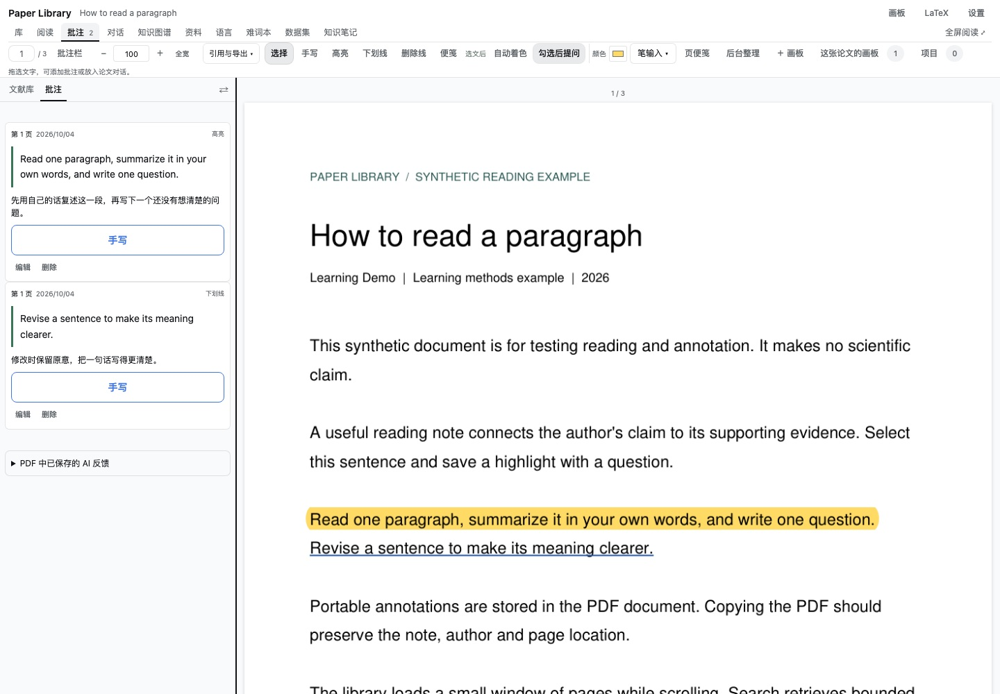
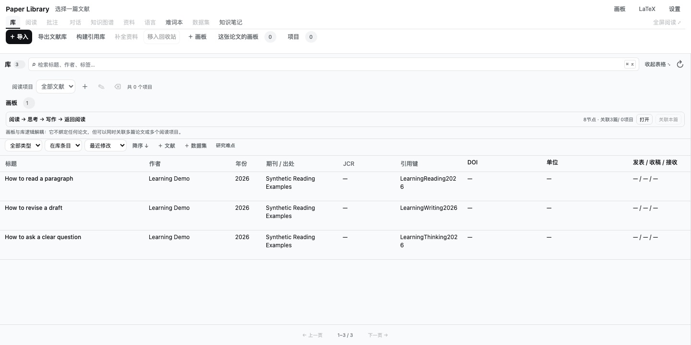
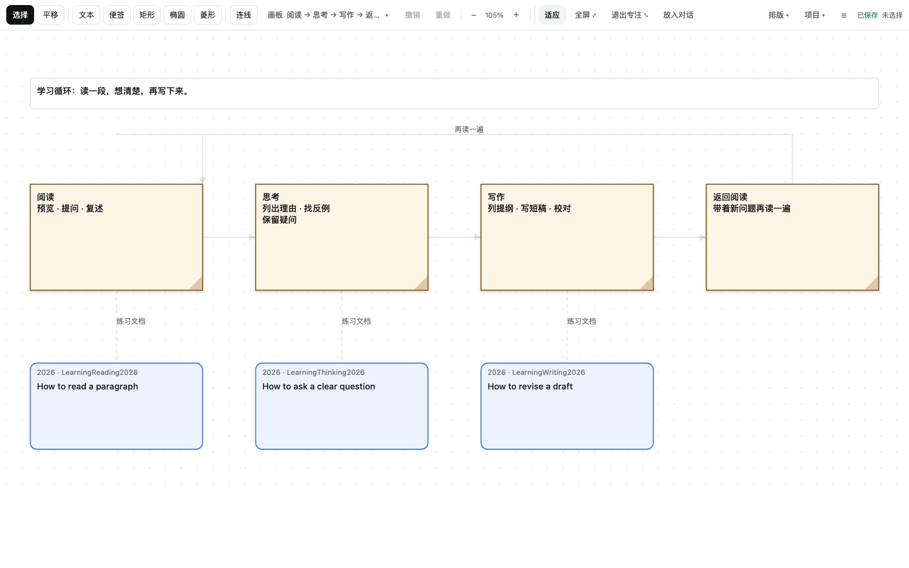
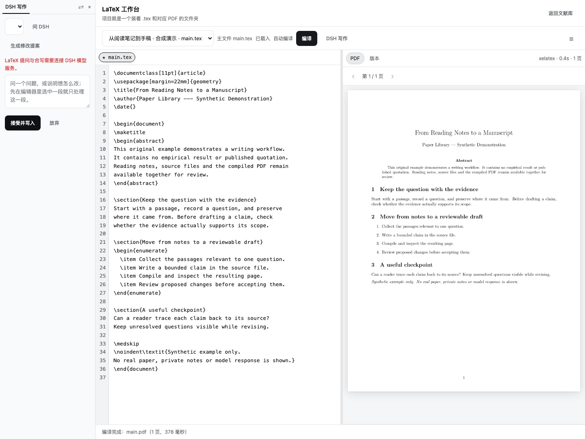

# DSH | Paper Library | Read, annotate, and write with your papers

> Unofficial project, independently developed and maintained by Mappedinfo. This is a community plugin, not an official DeepSeek product.

[Project](https://github.com/Mappedinfo/dsh-paper-library) · [English README and installation](https://github.com/Mappedinfo/dsh-paper-library/blob/main/README.en.md#installation) · [npm](https://www.npmjs.com/package/@mappedinfo/dsh-paper-library) · [Try the standalone board](https://mappedinfo.github.io/dsh-paper-library/)

**Paper Library is a local research workspace inside DeepSeek Harness.** Start with a PDF, leave a question beside a passage, continue the conversation with DSH, and bring useful evidence into a board, a LaTeX draft, or a slide deck.

It integrates with DSH's model services, sessions, tools, and Web authentication without requiring changes to Harness source. Each paper has its own conversation, shared between the plugin and the main DSH view. The plugin runs independently of Zotero and can import Zotero exports.

**This introduction covers current `main` as of November 9, 2026.** The npm release was still `0.2.5` when checked; several features below are newer than that release. Use the [source installation](https://github.com/Mappedinfo/dsh-paper-library/blob/main/README.en.md#installation) to try the current implementation.

## Keep the discussion beside the passage

Highlight or underline text, draw a rectangle around an image detail, or add freehand ink. These are standard PDF annotations stored in a managed copy; the imported original stays untouched, and annotations travel with the exported PDF.

A marked passage can have several notes and follow-up questions. Each note has its own **Ask DSH** action, with the AI reply kept underneath it. You can also select several annotations and ask one combined question. AI replies are labeled, selectable, and available to quote in another question.

## Find the part you want to read

The sidebar has directories for **formulas, figures, tables, and algorithms**. Jump to the original page, inspect a crop, or search the extracted text. Rotated tables have orientation-aware previews; supported pseudocode with explicit loops and branches can be turned into a flowchart.

This structural extraction uses local PDF processing and deterministic rules, not an LLM. Results remain candidates to check against the original: complicated layouts, scanned pages, and incomplete pseudocode can still need manual review.

For a deeper read, full-paper AI analysis works in page batches and retains the source evidence for each judgment. Browse the complete saved analysis by question and evidence, rather than trying to fit every result into one crowded drawing. In the library graph, the current paper's relationships can be highlighted against the surrounding context.

**Paper citations** provides a separate view of directed citation relationships. Supported numbered and author–year reference lists are parsed locally without an LLM. Entries keep their original text and page; exact DOI matches can connect to library papers. Shared authors and tags are not treated as citations, and uncertain entries do not get invented links.

## Collect papers and build a reading vocabulary

Import PDFs, DOI or public paper links, and JSON/RIS/BibTeX metadata. Review metadata suggestions, copy CSL-formatted APA 7 references, and export BibLaTeX. Organize papers with reading projects, favorites, and hierarchical tags such as `#methods/deep-learning`.

**Language & Entries** brings translation, bilingual vocabulary, and writing support together. Dock it beside the PDF to keep selecting passages while it stays open. It displays the effective translation target and offers grammar correction, conciseness, academic wording, logical flow, and plain-language explanation. Vocabulary records retain source sentences, translations, and links to the paper.

## Move from reading to writing

On a literature board, arrange papers, notes, concepts, and relationships; open the original PDF from a paper node. Boards support a Mermaid subset, draw.io interchange, and JSON export. AI changes remain proposals to review.

The LaTeX workbench puts source and compiled PDF side by side. Compile with your local TeX installation, navigate between source and PDF, and review DSH edit proposals before applying them. Revision checks protect against overwriting changes from another window.

For presentations, the integrated **PlainDeck** editor exports editable PPTX, HTML, and project ZIP files, with PDF available through printing. DSH tools can export a saved project directly. The synthetic PowerPoint demo includes entrance animations and camera-style zoom; playback was confirmed in PowerPoint. WPS playback remains unverified. ZIP projects can be reopened; PPTX import is not supported.

## Try the guide as the demo

The guide and slide deck are themselves practice material:

- [Eight-page PDF guide](https://github.com/Mappedinfo/dsh-paper-library/blob/main/docs/demo/guide.pdf) and [annotated copy](https://github.com/Mappedinfo/dsh-paper-library/blob/main/docs/demo/guide-annotated.pdf).
- [Ten-slide editable animated PPTX](https://github.com/Mappedinfo/dsh-paper-library/raw/refs/heads/main/docs/demo/slides.pptx).
- [PlainDeck project ZIP](https://github.com/Mappedinfo/dsh-paper-library/raw/refs/heads/main/docs/demo/slides.zip) to reopen and edit, plus a [static slide PDF](https://github.com/Mappedinfo/dsh-paper-library/blob/main/docs/demo/slides.pdf).

The downloadable manual and slides are currently in Chinese; the [English README](https://github.com/Mappedinfo/dsh-paper-library/blob/main/README.en.md) provides an English walkthrough and setup instructions. The [standalone board](https://mappedinfo.github.io/dsh-paper-library/) is available without installation, but does not connect to a paper library or DSH model. Export JSON to keep a durable copy.

## Background work you can control

Structure scans wait for idle reading time and run in small page batches, with pause/resume and saved progress. Resource presets offer processing targets of **256, 512, or 1024 MiB**, plus custom settings for caches, scan intervals, and disk budgets. These are workload targets, not a hard limit on total DSH/browser memory. Budget pauses show the reason and keep completed work.

Papers and records stay on the machine running DSH. Relevant passages, notes, images, or drafts are sent to the configured provider when a model feature uses them. There is no always-on embedding model or background preprocessing of the entire existing PDF library. Full-document OCR and full-text library search are not currently included.

Five interface palettes and separate dark-PDF / English bionic-reading controls let you adjust the workspace. Display modes do not modify the original PDF.

All screenshots here use synthetic documents and generic learning exercises. They show the versions documented in the [demo provenance](https://github.com/Mappedinfo/dsh-paper-library/blob/main/docs/community/README.md), not necessarily every latest control. They are not evidence of real-model answer quality or physical Pencil testing.

Original code is **MIT**. The default PyMuPDF/MuPDF and citeproc-js runtime choices involve **AGPL**, and CSL assets retain **CC BY-SA**; see [third-party licenses](https://github.com/Mappedinfo/dsh-paper-library/blob/main/THIRD_PARTY.md). Core library operations target macOS, Windows, and Linux; the [validation notes](https://github.com/Mappedinfo/dsh-paper-library/blob/main/docs/validation.md) describe the tested scope.

If you try it, feedback on the path from marking a passage to asking a useful follow-up would be especially helpful. [Report an issue](https://github.com/Mappedinfo/dsh-paper-library/issues) or reply here with the step that needs improvement.
