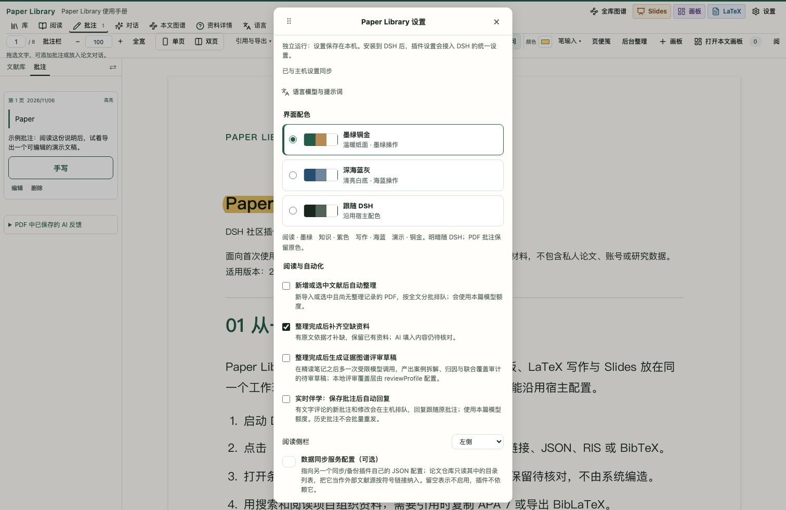
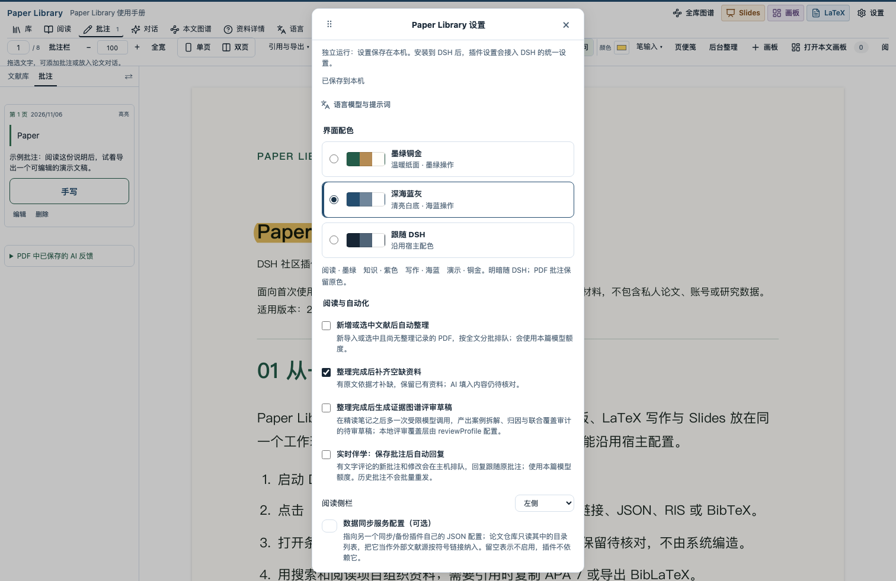
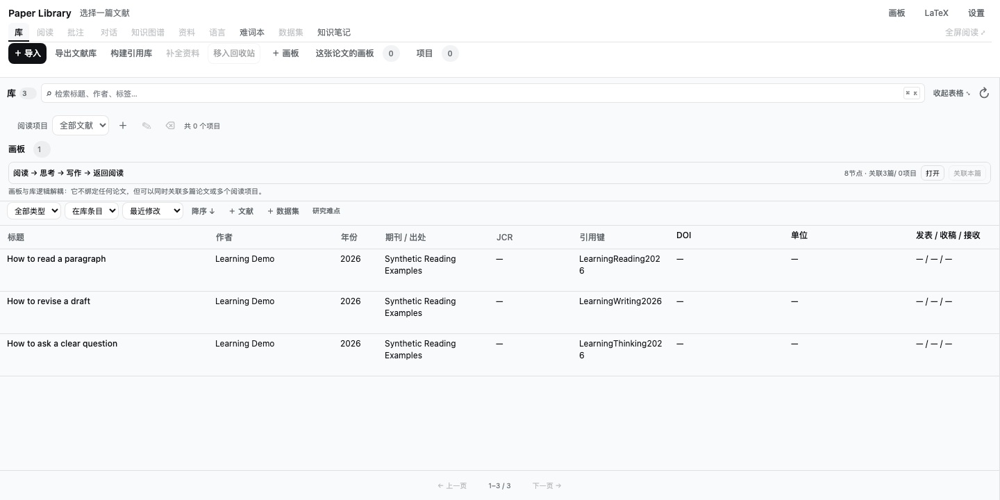
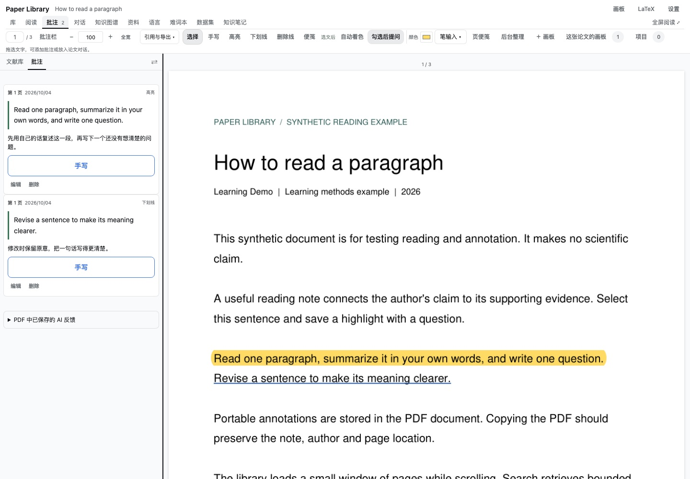
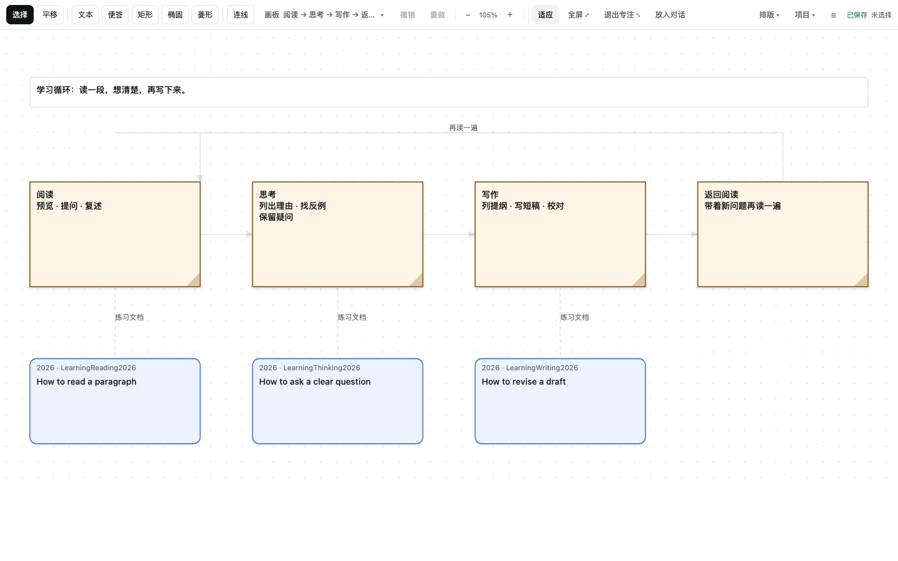
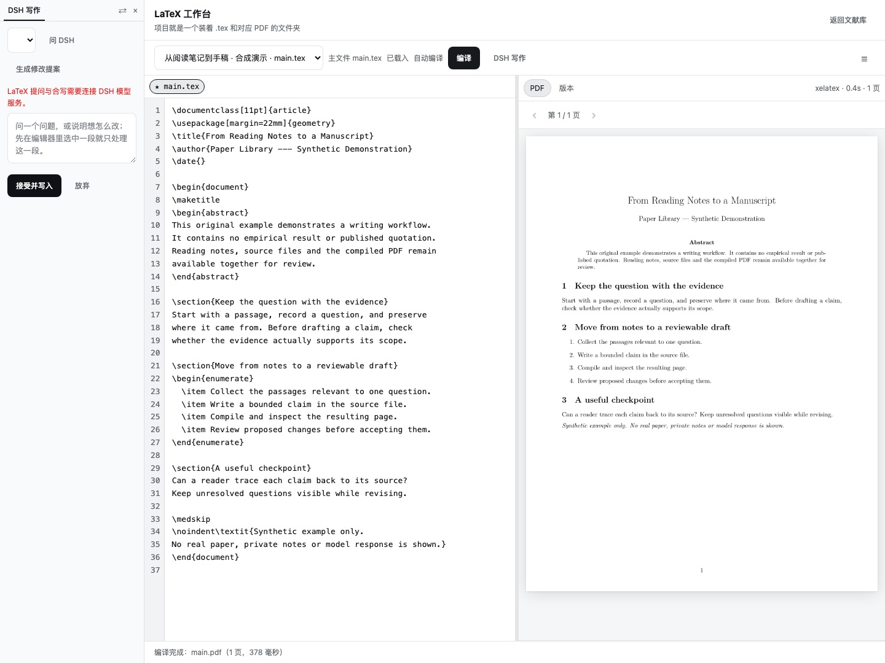
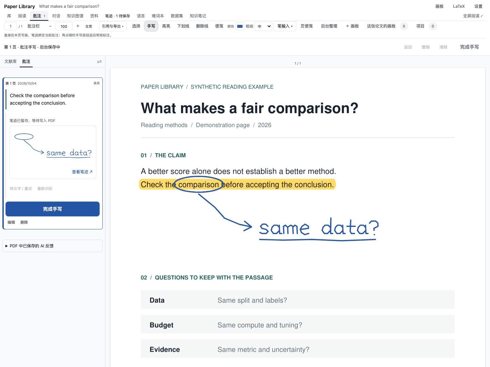
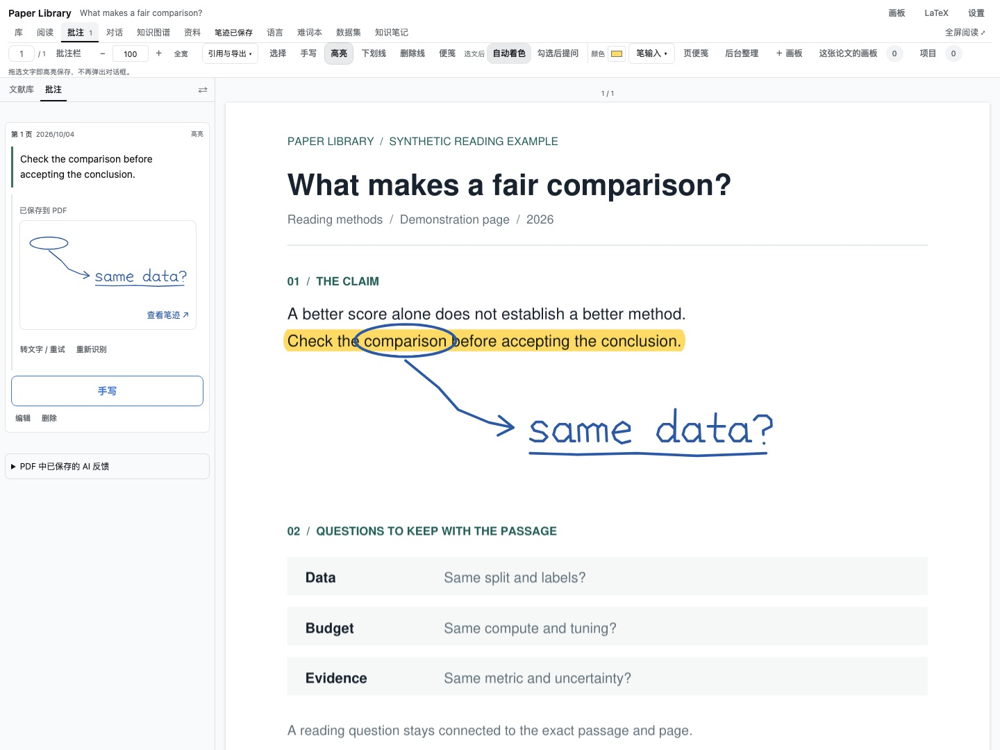
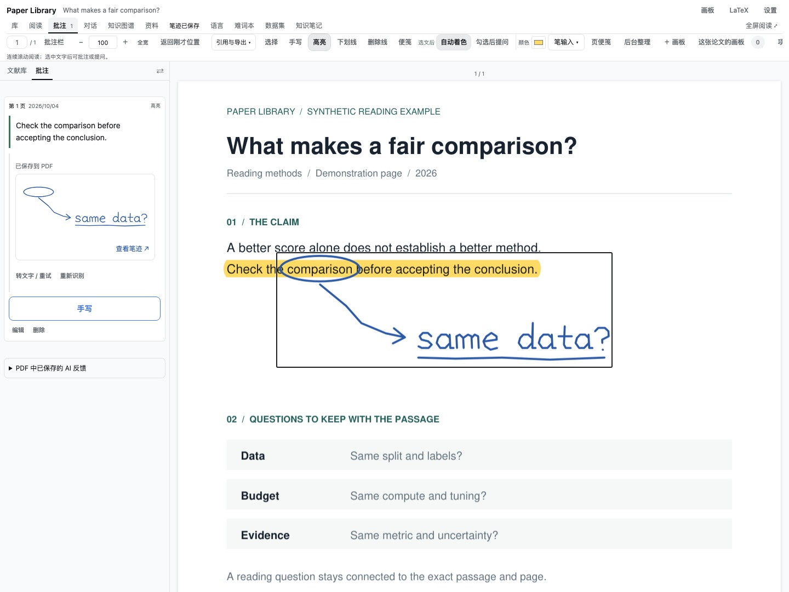

> **非官方项目，由社区成员独立开发和维护。**

项目地址 [Mappedinfo/dsh-paper-library](https://github.com/Mappedinfo/dsh-paper-library) · [安装与使用](https://github.com/Mappedinfo/dsh-paper-library#安装与开发) · [npm 包](https://www.npmjs.com/package/@mappedinfo/dsh-paper-library) · [独立画板](https://mappedinfo.github.io/dsh-paper-library/)

**Paper Library 是 DeepSeek Harness 里的本地文献与研究工作台。** 它把文献收集、PDF 阅读与批注、AI 对话、知识整理、文献画板、LaTeX 写作和 Slides 放在同一个插件里。

日常使用可以从一篇 PDF 开始。把论文导入文献库，阅读时留下批注，把需要追问的段落带进这篇论文的 DSH 对话；读过的文献按项目组织，把概念和证据放到图谱或画板，最后在 LaTeX 工作台里继续写作。论文、数据集、引用和阅读记录都可以在这个过程中反复使用。

插件独立于 Zotero 运行，也支持导入 Zotero 导出的资料；复用 DSH 的模型服务、会话和 Web 认证，无需修改 Harness 源码。

### 近期更新：把阅读中的问题留在原文旁

当前 `main` 已加入以下功能（2026-11-09）。npm 发布版仍为 `0.2.5`；想体验这些更新，请使用源码安装。

- **同一处划线，连续追问**：备注 1、备注 2 和 AI 回复都跟在原批注下，各有提问入口；也可以批量选中几条批注，一次提问。矩形框和自由笔画保存为原生 PDF 批注，区域截图帮助回看图片细节。
- **按结构读论文**：侧栏直接浏览公式、图片、表格和算法，点击回到原页。支持旋转表格转正预览、流程图候选裁剪，以及从明确循环／分支伪代码构建流程图。提取依赖版面与文本规则，不依赖 LLM；复杂表格、扫描页及未识别结构仍需核对原页。
- **把语言学习放在阅读旁边**：「语言与词条」支持大窗口／侧边窗切换，选文时保持打开；显示当前翻译目标，并提供语法纠错、精简表达、学术表达、逻辑衔接和通俗解释。翻译中有学习价值的词组可积累为双语词条，保留原句、译文和文献来源。
- **更容易找回文献与证据**：收藏论文，用 `#方法/深度学习` 等层级标签筛选；全文分析结果逐层浏览，论文引用模式展示有原文依据的引用关系。参考文献按规则解析，无法可靠识别的条目保留原文，不猜测连线。
- **后台工作可控**：结构扫描等阅读操作空闲后逐页运行，支持暂停与续扫。资源设置有节能 256 MiB、均衡 512 MiB、高性能 1024 MiB及自定义档位；这些是处理与缓存目标，不是整个 DSH 的内存硬上限。达到预算时显示原因并保留进度。

### 可下载的使用说明与 Slides 示例

把 [8 页 PDF 手册](https://github.com/Mappedinfo/dsh-paper-library/blob/main/docs/demo/guide.pdf)导入文献库阅读批注；把 [PlainDeck ZIP](https://github.com/Mappedinfo/dsh-paper-library/raw/refs/heads/main/docs/demo/slides.zip)导入 Slides，修改内容再导出。另提供 [10 页动态可编辑 PPTX](https://github.com/Mappedinfo/dsh-paper-library/raw/refs/heads/main/docs/demo/slides.pptx)、[静态 PDF](https://github.com/Mappedinfo/dsh-paper-library/blob/main/docs/demo/slides.pdf) 和[带批注的手册副本](https://github.com/Mappedinfo/dsh-paper-library/blob/main/docs/demo/guide-annotated.pdf)。说明本身就是演示材料，不含私人资料。[主稿与复现方法](https://github.com/Mappedinfo/dsh-paper-library/blob/main/docs/demo/README.md)

Slides 集成 PlainDeck，支持主题、原生表格、制作指导、放映以及 PPTX／HTML／ZIP 导出。DSH 原生工具可查找并导出已保存项目。PPTX 保留可编辑对象、入场动画与镜头缩放；独立合成稿已由用户在 PowerPoint 放映确认，WPS 尚未验收。ZIP 可以重新导入，PPTX 导入目前不支持。

设置中可切换墨绿铜金、深海蓝灰、石墨中性、樱粉柔光、杏橙暖光或跟随 DSH。阅读、知识、写作和 Slides 分别使用墨绿、紫色、海蓝与铜金；界面明暗跟随宿主，PDF 可单独开启深色显示和仿生阅读；显示切换不改原文件。新增功能以当前源码为准，不代表 npm 已发布同等版本。

### 文献收集、管理与引用

把 PDF 拖进窗口，或粘贴公开论文链接、DOI、arXiv 地址，就能开始整理文献。支持多 PDF 顺序导入，以及 JSON、RIS、BibTeX 等元数据导入；已有 Zotero 导出资料也可以带进来。

文献库可以按标题、作者、年份、DOI、引用键、标签和摘要检索，展开表格后继续排序、编辑资料、补全公开元数据。阅读项目用于管理不同主题，一篇论文可以属于多个项目。已有 PDF 目录也可以通过可选的外部文献源接入，首次批注时才生成管理副本。

引用方面支持 APA 7 富文本与纯文本、BibLaTeX 导出，也能生成 `references.bib`，检查引用键和 DOI 冲突。缺失的作者、日期等信息会保留为待核对项。

### PDF 阅读、批注与论文对话

阅读器支持连续滚动、缩放、全屏和可调整宽度的侧栏。高亮、下划线、删除线、便笺、矩形框、自由笔画与评论写入管理副本 PDF；文中批注与侧栏条目可以互相定位。批注随 PDF 导出，导入的原文件保持不变。

每篇论文有自己的 **DSH 对话**。可以对一条选文直接提问，也可先写备注，或批量选择几条批注一次提问；另有放入主输入框的草稿入口。插件内与 DSH 主页面使用同一段历史。关联的 AI 回复可以保存在对应批注下，明确标为 AI 内容，回看时仍能找到当时引用的原文。

可选的 **实时伴学** 可按批注事件排队回应；侧栏备注自动保存本身不触发模型，点「问 DSH」才提交。选文可以直接翻译、优化表述；「语言与词条」保留原句、论文出处和可编辑释义。

### 从阅读记录到知识、证据与数据集

有文字层的 PDF 可以交给 DSH 分批阅读全文，生成带出处的知识图谱、精读笔记和评审草稿。读者可以查看原文与已知页码，核对主张、方法、数据和证据之间的关系，再选择材料加入论文对话。AI 产出始终是待核对内容。

知识笔记、证据图谱和手工关系可以分别维护。针对明确选中的文献，也提供研究难点候选提取、跨篇主题复核与导出，便于把后续阅读问题整理出来。

数据集有独立条目、版本、文件登记和引用信息，可与论文建立提及、使用、发布等关系并附上证据。本地 CSV、TSV、JSONL 提供有界样本预览，适合先核对字段和内容，再决定如何使用数据。

### 用文献画板组织多篇论文

画板支持文本、便签、形状、连线、撤销重做与自动排版。可以把文献作为节点加入，同一张画板关联多篇论文或多个阅读项目，双击文献节点回到阅读器。

画板可以导入导出 Mermaid 子集和 draw.io 文件，也有可读的 JSON 源文件。把画板放进 DSH 对话时，会固定当时的内容供模型引用；AI 新增或修改的节点标为提议，由读者审阅接受。

下图只展示通用学习方法：阅读一段材料、想清楚、写下来，再带着问题返回阅读。前三步各关联一篇合成练习文档。

同一套画布也提供[独立网页版本](https://mappedinfo.github.io/dsh-paper-library/)，可以先体验画图和排版。独立版不连接文献库或 DSH 模型，长期保留内容请导出 JSON。

### 在 LaTeX 工作台继续写作

工作台采用源码与 PDF 并排布局，支持登记已有论文项目或创建新项目、保存、调用本机 TeX 编译、查看错误和历史差异。DSH 写作协作使用同一套可收起的阅读侧栏。

可以把当前源文件或选中片段交给 DSH 提问，也可以生成修改提案，检查具体替换内容后再接受写入。编辑和 AI 改动都检查文件修订，避免覆盖另一窗口已经保存的内容。编译需要本机安装 `latexmk` 和相应 TeX 引擎。

### 用笔把想法留在原文旁

在这些阅读与批注功能之上，插件还支持 **关联手写**。先高亮一句话，再点侧栏这条批注的「手写」，直接在原 PDF 上写字、圈图和画箭头；顶部也保留自由手写。笔迹与批注一起保存，保留它们在页面上的位置关系。

关联手写时，停笔约 1.5 秒后自动暂存；点「完成手写」立即回到之前的标注工具，保存继续在后台进行。状态和操作合并在固定的一行中，落笔或自动保存不会再把页面往下推。

查看手写预览、跳回原页与转文字

批注卡片显示原笔迹预览。点摘录回到原文，点预览回到手写位置，目标短暂描亮；看完可以返回刚才的阅读位置。页面笔迹保存为标准 PDF Ink，并保留与高亮的关联。

接入 DSH 视觉模型后，可以在结束手写后自动转文字并校对，原笔迹继续保留。识别会把笔迹图片发送给当前配置的 DSH 视觉模型。

手写按 Apple Pencil 随航阅读场景开发，目前以 Chrome 验证。笔与手指能否分开识别取决于系统和浏览器事件；物理 Pencil／随航、Safari 和 Electron 仍需设备验证，当前没有压感、双击或挤压切换工具。[完整手写说明](https://github.com/Mappedinfo/dsh-paper-library#pencil-文字标注与关联手写)

### 安装、存储与适用范围

安装后从 DSH 右侧面板打开「文献库」或「画板」。插件提供文献、引用、批注、画板等工具和配套技能，可以在 DSH 会话中直接调用；设置中的偏好与插件界面共用。

**完整体验本文展示的当前功能，请按 [README](https://github.com/Mappedinfo/dsh-paper-library#安装与开发) 安装 `main` 源码。** 本文功能说明更新至 2026-11-09；npm 当前发布版为 `0.2.5`，源码与 npm 分别维护，功能以实际安装版本为准。现有演示截图和下载手册仍对应其复现记录中的版本。源码安装需要 Node、Python、uv 和已构建的本地 DSH checkout。

资料和状态保存在运行 DSH 的本机；使用模型功能时，相应原文、批注或稿件会提交给已配置的 DSH 模型服务。PDF 处理按需运行，阅读时只渲染附近页面；没有常驻向量模型，不会在后台自动解析现有全库 PDF。自动整理针对导入或选中的论文，扫描页尚无全文 OCR。元数据检索、AI 草稿和真实模型质量的验证范围见[验证记录](https://github.com/Mappedinfo/dsh-paper-library/blob/main/docs/validation.md)。

本文截图使用合成文献、图示与稿件。当前公开演示仅采用通用阅读、思考与写作方法；手写截图使用程序输入的演示笔画，截图不代表真实模型输出质量或物理 Pencil 测试。[截图来源与复现](https://github.com/Mappedinfo/dsh-paper-library/blob/main/docs/community/README.md)

原创代码采用 **MIT**；默认 PyMuPDF、citeproc 运行时涉及 AGPL，CSL 资源保留 CC BY-SA，详见[第三方许可](https://github.com/Mappedinfo/dsh-paper-library/blob/main/THIRD_PARTY.md)。

欢迎把 Paper Library 用到日常收集、阅读、整理和写作中，也欢迎反馈哪个环节还不顺手。
