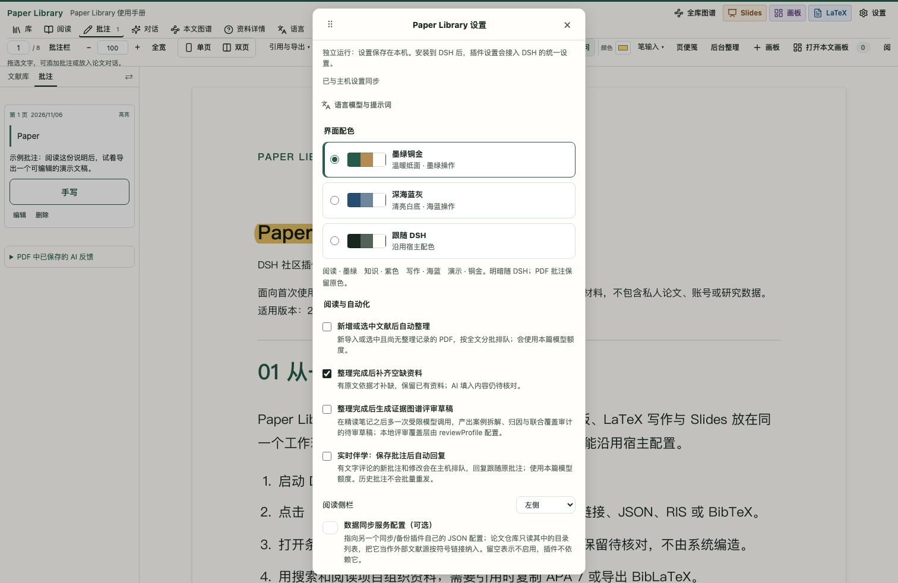
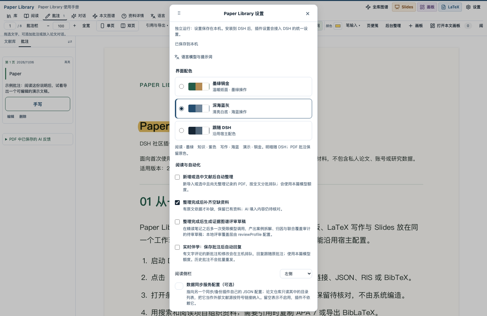

### 2026-11-06：可切换主题、动态 PPTX，以及能直接试用的说明项目

这次把使用说明本身做成了演示：先把 PDF 手册导入文献库，留下批注；再导入配套 PlainDeck ZIP，改一句话，保存并导出 PPTX。

- [PDF 使用手册（8 页）](https://github.com/Mappedinfo/dsh-paper-library/blob/main/docs/demo/guide.pdf) · [带原生批注的示例](https://github.com/Mappedinfo/dsh-paper-library/blob/main/docs/demo/guide-annotated.pdf)
- [下载可编辑动态 PPTX（10 页）](https://github.com/Mappedinfo/dsh-paper-library/raw/refs/heads/main/docs/demo/slides.pptx) · [下载 PlainDeck 项目 ZIP](https://github.com/Mappedinfo/dsh-paper-library/raw/refs/heads/main/docs/demo/slides.zip)
- [Slides 静态 PDF](https://github.com/Mappedinfo/dsh-paper-library/blob/main/docs/demo/slides.pdf) · [主稿与复现说明](https://github.com/Mappedinfo/dsh-paper-library/blob/main/docs/demo/README.md)

**设置 → 界面配色** 新增「墨绿铜金」「深海蓝灰」，也可选择跟随 DSH。阅读用墨绿，知识与画板用紫色，写作用海蓝，Slides 用铜金；切换主题仍保留这些功能含义。明暗随宿主，PDF 页面和批注保留原色。

**Slides 导出 PPTX** 保留文字、形状、图片与表格等可编辑对象，并支持原生入场动画与镜头缩放。DSH 可以通过 `library_slides_list` 找到项目，再用 `library_slides_export_pptx` 导出已保存的版本；本套示例已通过运行中的 DSH 创建和导出。PlainDeck ZIP 可以重新导入；目前不支持把 PPTX 导回 PlainDeck，PDF 是静态输出。

两套主题完成了设置与深浅模式检查。独立合成动态稿已在 PowerPoint 放映中确认淡入与镜头缩放；本套 10 页稿完成导出和版面检查，WPS 尚未验收。演示只包含公开使用说明，不使用私人文献或研究数据。

这些更新已进入源码 main，本条是源码进展与示例更新，不是新的 npm 发版公告。[安装源码版](https://github.com/Mappedinfo/dsh-paper-library#安装与开发)时请核对环境和依赖许可：项目原创代码为 MIT，默认 PyMuPDF 为 AGPL／商业许可。
