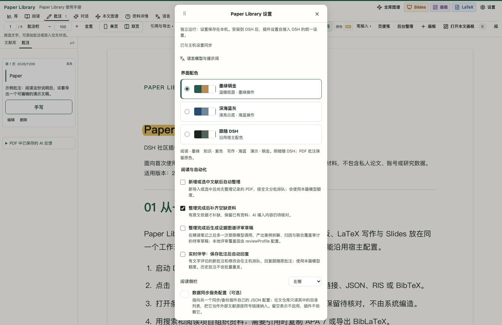
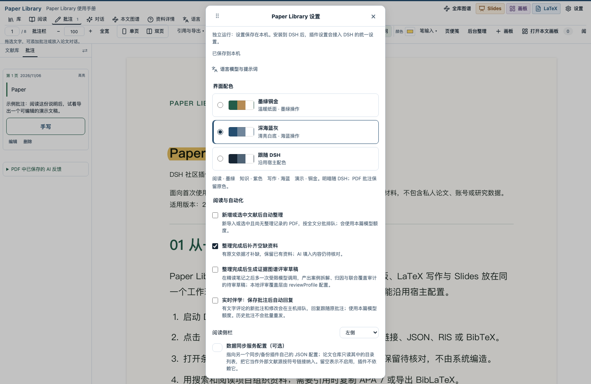
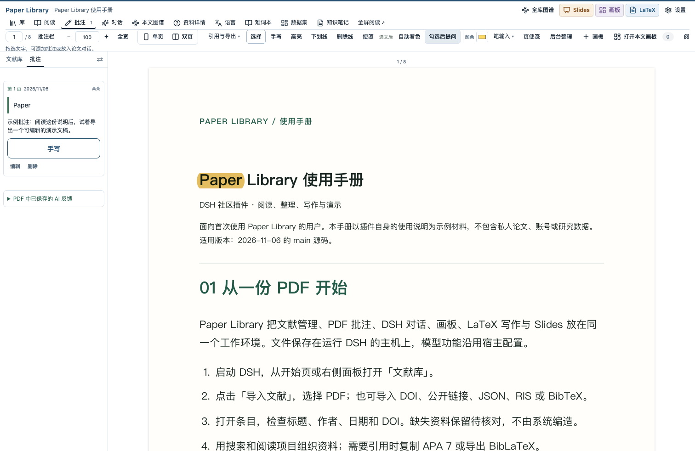

# 使用说明也是演示项目

本目录只使用 Paper Library 的公开操作说明，不含私人文献、账户、研究资料或模型回复。适用范围为 2026-11-06 源码；新增主题与动态 PPTX 不代表已经发布新的 npm 版本。

| 文件 | 用法 |
| --- | --- |
| [guide.md](guide.md) | 可独立阅读的说明主稿 |
| [guide.pdf](guide.pdf) | 8 页手册，导入文献库后练习阅读与批注 |
| [guide-annotated.pdf](guide-annotated.pdf) | 同一手册的管理副本，携带一条标准 PDF 高亮与评论 |
| [slides.pptx](slides.pptx) | 10 页可编辑演示，入场动画与镜头写入原生时间轴 |
| [slides.zip](slides.zip) | PlainDeck 项目，可导入 Slides 继续编辑 |
| [slides.pdf](slides.pdf) | 10 页静态演示稿，适合阅读与打印 |
| [slides.html](slides.html) | 下载后用浏览器打开的 HTML 演示 |
| [slides.json](slides.json) | 完整 PlainDeck 文档数据 |

## 复现

在已完成构建的项目中运行：

```sh
node scripts/build-user-guide.mjs
node scripts/capture-guide-demo.mjs
```

生成脚本使用 Playwright、Marked 与项目既有 PlainDeck 转换器；可通过 `PLAYWRIGHT_MODULE` 和 `MARKED_MODULE` 指定这两个模块的绝对入口。截图脚本默认使用 `.venv/bin/python`，在 Git 忽略的 `.local/` 中新建隔离资料库，关闭自动分析／伴学，拦截非本地网络，不读取真实资料库。PDF 中文排版使用本机 PingFang SC；其他系统需安装匹配字体后检查版面。

生成脚本检查页面与文字溢出；10 页 Slides 已逐页视觉检查，修改了封面页脚对比度与第 4 页断行。PDF、两套主题的截图与实际界面操作另行核对。原件 0 条批注、演示副本 1 条批注；10 页 PPTX 均含原生时间轴。已在本地 DSH 通过 HTTP 创建并导出同一 Slides 文档，结果无警告。此次没有重复执行模型生成或 PowerPoint 现场放映；此前独立两页动态夹具的淡入及镜头缩放已由用户在 PowerPoint 放映确认，WPS 尚未验收。






