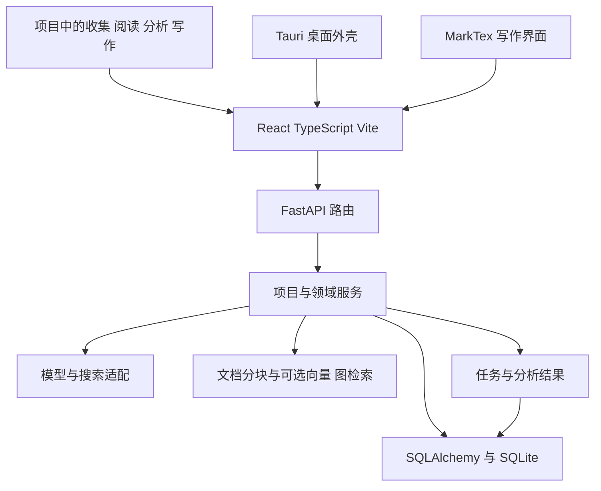

# GapFinder 架构与设计迁移审查

GapFinder 最值得迁入 Paper Library 的设计，是让项目、观点、证据和写作材料在不同工作步骤之间持续可用。建议优先补齐**项目上下文、观点卡片、写作材料包**，复用本项目已有的目录、来源快照、知识图谱、DSH 会话和 LaTeX 修改提案。GapFinder 的整套运行时和自动研究流程不适合作为迁移单位。

审查日期为 2026-10-26。以下“已有”指当前工作区中的实现，“建议”指尚未接受的迁移方案。本轮完成源码静态审查，未启动 GapFinder、调用模型或操作文献资料。源码依据及版本指纹见[来源清单](gap-finder-design-review.sources.json)。

## 两个项目的架构

### GapFinder 的运行结构



当前主链是 `web/ → python_server/app/ → SQLite`，Tauri 加载同一前端并负责启动后端。开发模式由 Vite 代理 `/api` 和 `/ws`；工作流调用通过 JSON、SSE 或 WebSocket 返回。`electron/` 留有历史路径，README 已将 Electron 时代的架构归为历史。[G1][G2]

| 层次 | 实际职责 | 关键入口 |
| --- | --- | --- |
| 产品导航 | 项目选择；Library、Read、Write、Data 工作流；旧路由重定向 | `web/src/App.tsx`、`config/workflows.tsx` |
| 前端状态 | 当前文献、阅读队列、任务托盘、上下文面板；部分状态存浏览器 | `store/workspaceStore.ts`、`components/workspace/ContextPanelHost.tsx` |
| 服务入口 | FastAPI 路由、数据库生命周期、工作流执行与事件传递 | `python_server/app/main.py` |
| 业务服务 | 项目材料、观点卡片、术语、Gap 发现与匹配、综述、写作 | `python_server/app/services/` |
| 数据模型 | 通用 Node/Relation；专用 Claim、Project、Task 等表 | `python_server/app/db/models.py` |
| 外部能力 | 模型客户端、多来源搜索、PDF 获取、可选向量检索和 MS-Agent | 对应 `services/` 模块与 `orchestrator.py` |
| 编辑与外壳 | MarkTex 子模块提供写作资源；Tauri 提供桌面能力 | `web/vite.config.ts`、`src-tauri/src/main.rs` |

`Analyze` 仍有路由，但主工作流配置把分析工具收进 Library；不能把 README 中的流程箭头理解为六个独立顶层工作区。当前工作区还挂载了论文投稿流程页面和 AI 健康诊断，其中部分文件未提交，应视为本地新增实现。[G1][G3]

### GapFinder 的领域对象

```text
Project
  ├─ ProjectItem → 候选来源 / 已入库 Node / 笔记 / 写作输入
  ├─ ProjectConversation → ProjectMessage
  └─ ProjectArtifact → 分析结果 / 综述 / 写作材料

Node(document) → DocumentChunk
  └─ ClaimCard → ClaimSource
       └─ ClaimEvidence → 支撑 / 批判 / 关联观点

GapMatchRun / Task → 配置、状态、结果、错误
```

其关键设计是把“文章”“文章中的观点”“围绕观点的证据”“项目产物”分开。观点卡片可以审阅、编辑 Markdown/LaTeX、检索和导出；模型执行结果还保存技能版本、模型、用量和关联文献。阅读内容因此可以继续参与分析和写作。[G3][G4][G5]

存储边界仍有演进痕迹：Node/Relation 的主要载荷是 JSON 文本，新能力又使用专用表；README 和当前配置将默认数据库指向 `user-data/gapfinder.sqlite`，架构文档仍写 `python_server/db/gapfinder.sqlite`。实际运行还可由环境配置覆盖，本次未启动核验。[G1][G3]

`literature_lens_lite/` 是独立五维编码 CLI，README 明确说明未接入主应用；`obsidian-literature-lens/` 和 `obsidian-note-highlight/` 是另行开发的 Obsidian 插件。这些当前为未跟踪目录，不能计入主应用已经交付的能力。[G12]

### Paper Library 的迁移承接点

Paper Library 使用 DSH 宿主适配层或独立 Node 服务，经动作白名单调度短时 Python worker；目录与结构化知识保存在用户资料库，PDF 标准对象承载批注。DSH 原生会话承载模型与对话，本机状态服务承载草稿、来源选择和作业检查点。[P1][P2]

| 已有能力 | 当前证据 | 对迁移的意义 |
| --- | --- | --- |
| 阅读项目 | `projects` 与 `project_papers` 多对多关联；解除关联保留论文 | 继续扩展现有项目身份 |
| 结构化知识 | Claim、Evidence、Observation、Gap 等类型；支持、限定、反驳关系；精确引文校验 | 观点卡片可以成为现有知识的视图 |
| 审核与来源 | 固定来源、哈希、修订检查、待审草稿和显式审核 | 迁入的界面必须保留这些约束 |
| 研究难点 | 扫描、主题聚合、审核、清单对照和导出 | 单向难点抽取已有实现 |
| LaTeX 工作台 | 文件修订、提案、接受后写入、自审与定位 | 写作材料可进入现有写作路径 |
| 执行恢复 | 请求身份、结果检查点、持久队列、有界并发 | 任务可见性应投影现有记录 |

目前阅读项目的成员仍是论文，统一资源查询的项目过滤也明确限定 `kind='paper'`；知识草稿以 paper/dataset/release 为归属，LaTeX 项目有自己的身份。它们之间缺少一个贯穿项目任务的材料关联入口。这是本次最有价值的迁移切入点。[P3][P4][P5][P6]

## 值得迁移的设计原则

从上述架构可以归纳出五条原则。其价值在于指导本项目的小步改进，具体实现仍需服从 Paper Library 的来源、审核与资源预算。

| 原则 | GapFinder 中的体现 | 对本项目的启示 |
| --- | --- | --- |
| 围绕研究任务保持上下文 | 项目贯穿资料、阅读、分析和写作页面 | 页面切换继续携带范围与所选材料 [G1][G6] |
| 把中间结果保存成可复用对象 | ClaimCard、SkillResult、ProjectArtifact 各有身份 | 已读内容能成为可审阅、可导出的写作材料 [G3][G4][G5] |
| 让材料的状态转换可见 | 候选与入库分开，卡片有待审、接受和否决状态 | 显示每一步改变了什么，并在消费材料时执行状态约束 [G4][G6] |
| 将可复核的计算交给程序 | Gap Frontier 公开计算分项，综述路径检查引文匹配 | 程序负责计数、定位与版本检查；公式选择及学术解释另需依据 [G8][G14] |
| 共享工作界面，隔离外部能力 | Tauri 与网页共用前端，搜索源通过适配器接入 | 继续共享现有阅读与写作组件，按需求增加窄接口 [G2][G10] |

## 迁移价值与优先级

“优先”表示下一轮最值得实施的建议，不表示本轮已经迁移或形成新的开发承诺。

| 设计 | 必要性判断 | 最小迁移方式 |
| --- | --- | --- |
| 项目上下文贯穿工作流 | **优先**；现有项目主要承担论文分组 | 以原项目 ID 关联已有知识、主题、画板和稿件 |
| 观点成为可复用卡片 | **优先**；逐篇图谱不便跨篇取用 | 投影已审图中的 Claim 及证据关系 |
| 写作材料持续保留出处 | **优先**；阅读结果到稿件仍需人工搬运 | 显式选择材料，固定版本后送入现有写作提案 |
| 双向核对研究缺口 | **后续**；为现有难点模块补充反证路径 | 对照“旧文提出的缺口”和“新文声称解决的问题” |
| 固定维度后比较文献 | **后续**；有明确综述比较问题时有用 | 查询既有受审编码，先做表格和统计导出 |
| 外部搜索候选暂存 | **按需**；用户需要多来源发现入口时再做 | 搜索结果与正式入库分开，显式确认后导入 |
| 学术术语词典 | **按需**；需要持续编纂概念时再做 | 与现有语言难词本分开，复用 concept 与知识笔记 |
| 能力与任务状态可见 | **小步完善**；底层机制大多已有 | 展示真实作业状态、缺失依赖和恢复动作 |

## 优先迁移的三个设计

### 项目上下文贯穿阅读与写作

GapFinder 将项目 ID 带进页面路由，并把候选来源、对话、分析产物和写作材料挂到同一项目。它解决的是“换一个页面后，还能否继续处理刚才选定的材料”。值得迁移的是这份上下文连续性。[G2][G3][G6]

Paper Library 可在现有阅读项目上增加对已有资源的有类型关联，并明确区分阅读项目与 LaTeX 项目。界面展示当前范围，提供项目内的论文、观点、难点主题、画板和稿件入口。论文仍由原目录持有，一个对象可以进入多个项目。

项目范围用于筛选；**本次送给模型的材料范围仍须单独选择并冻结**。GapFinder 的 `build_project_context` 即使收到材料选择，也会另外追加最近的项目产物，并最终裁到 12,000 字符；这段上下文组装不宜照搬。本项目应显示实际引用条目、预算和省略情况。[G6][P4]

建议验收：同一论文加入两个项目后身份不变；切换项目保留阅读草稿与位置；解除材料关联保留原对象；仅选择项目不读取全库 PDF；生成请求只含本次确认的来源。

### 将观点卡片作为现有图谱的使用界面

GapFinder 的 ClaimCard 将观点正文、来源引文、跨篇支撑与批判、审核状态和可编辑写作片段放在一起。与逐篇查看原始分析结果相比，这个单位更适合回答“这一段论证有哪些依据和反例”。[G4]

Paper Library 已有更细的认识关系：`supports`、`qualifies`、`contradicts`。建议保留三者，以 `草稿 ID + 类型 + 节点 ID` 标识观点，查询其固定来源、页码和相关断言，形成可筛选的卡片视图。同名观点只提供关联建议，跨篇合并由用户判断。[P4]

第一版无需再做一次模型抽取，也无需建立另一套 Claim 权威存储。优先展示已接受草稿；待审内容提供独立筛选。跨篇关系若超出现有端点合同，先展示对照材料，再单独定义关系语义。

GapFinder 卡片写入路径主要检查来源非空、字段合法和去重，没有在该路径逐条核对摘录是否属于所指原文；综述加载又使用 `status != rejected`，会纳入待审卡片。迁移应保留 Paper Library 的精确来源校验与审核状态，不继承这两个较宽的边界。[G4][G8][P4]

建议验收：卡片能回到固定摘录与真实页码；支持、限定、反驳分别显示；已接受与待审状态明确；导出携带原始引用键；同名但出处不同的观点不会自动合并。

### 将写作材料包接入现有 LaTeX 提案

GapFinder 用 ProjectArtifact、写作上下文面板及综述结构保留阅读产物，使写作能继续使用前一步的结果。Paper Library 可以把已有观点、难点和知识笔记整理为一次写作所需的材料包。[G3][G7][G8]

材料包建议记录以下内容：

| 内容 | 用途 |
| --- | --- |
| 阅读项目与目标稿件标识 | 明确材料服务哪个项目、进入哪份稿件 |
| 所选观点、主题、笔记 ID 与修订 | 回溯本次采用的具体版本 |
| 固定引文、原始来源 ID、页码与哈希 | 核对论证依据与来源变化 |
| 引用键与书目身份 | 复用既有引用构建及冲突检查 |
| 审核状态、范围与预算 | 区分可用材料、候选材料和未覆盖部分 |

可变正文继续归原笔记或稿件持有；材料包保存引用清单及必要的固定快照。选择材料、预览材料均不调用模型；用户发起写作后，将材料交给现有 LaTeX 提案流程，接受时继续核对稿件修订。[P4][P6]

建议验收：不调用模型即可导出可读材料包；缺少引用键或出处时明确提示；源材料改变后能识别旧版本；模型改稿仍须审阅；稿件已修改时拒绝套用旧提案。

## 有明确需求再迁移的设计

### 双向核对研究缺口

GapFinder 的正向路径从论文提取局限与未来工作，反向路径从新论文的 Introduction/Related Work 提取它声称解决的前人问题，再追溯引用链。前后对照有助于发现“作者说有缺口，但后续工作已经处理”的情况。[G9]

Paper Library 已有难点抽取、来源分级和主题聚合。下一步可以在用户选定的前后两组论文之间增加对照表：前人缺口、后文贡献声称、适用条件、实际评价、仍未覆盖部分。新文的贡献声称与实测解决程度应分别记录。第一版采用表格即可，引用链扩展仍须用户选择并设置预算。[P5]

### 按问题与方法等维度比较文献

独立的 Literature Lens Lite 支持固定若干维度，再观察其余维度的分布和组合。这个设计适合具体比较，例如“在相同任务和数据条件下，不同方法报告了什么结果”。它比单纯扩展标签列表更能服务综述问题。[G12]

迁移时先查询本项目已核对的任务、方法、数据、指标和结果编码。研究贡献与价值需要单独的论证依据，不能由五个标签齐全推定。Lite 的 `merge_llm_tags` 会给结果设置固定置信度，并按维度是否为空决定待审状态；这部分不适合复用。多标签组合按笛卡尔积计数，组合总数可能超过论文数，界面必须分别报告去重论文数和标签组合数。[G12][P4]

建议验收：结果保留原论文与来源身份；缺失编码可见；改筛选条件只重算本地结果；空单元格表示当前语料没有已编码记录，不能直接解释为领域研究空白。

### 外部搜索候选与正式入库分离

GapFinder 的项目搜索默认保存候选，明确要求入库时才进入正式目录；来源适配器统一输出结果、可用性与错误。值得借鉴的是这两个边界，尤其适合扩展多来源检索。[G6][G10]

Paper Library 当前已能按 DOI、URL 或文件导入。只有增加学术搜索入口时，才需要候选暂存与适配器合同：保留来源、原查询、去重身份、错误和抓取时间，选择后调用现有导入路径。候选摘要保留元数据证据级别，PDF 下载使用独立动作和预算；私人全文及批注不进入公共搜索请求。

`SearchEngineRegistry.search_all` 的注释声称并行，但实现先保存协程、再逐个 `await`；项目另有搜索路径使用不同实现。可借鉴结果合同，不能据此宣称该注册中心已提供可靠并发。[G10]

### 学术术语与任务可见性

GapFinder 的术语页先展示词条，再按需编纂定义和来源。若用户需要跨篇维护学术概念，可在现有 concept 与知识笔记上提供类似视图；语言难词本继续承担语言学习职责。词语共现只能提供导航线索，不能升级为概念之间的学术关系。[G11][P4]

任务托盘和能力诊断也有借鉴价值，但应读取本项目已有作业与检查点。浏览器队列和托盘不能替代主机持久状态；“依赖已安装”“模型已配置”“真实请求成功”要分别显示。当前无需新增通用任务平台。[G7][G13][P2]

## 不建议迁移的实现

| 实现 | 源码观察 | 对 Paper Library 的取舍 |
| --- | --- | --- |
| FastAPI 常驻后端与 Tauri 外壳 | 适合 GapFinder 的独立桌面产品结构 | 保留 DSH 宿主与按需 worker，避免增加第二套服务生命周期 |
| 完整 MS-Agent 专家编排 | 独立运行时、专家配置和执行入口并存 | 复用当前 DSH 能力；本次材料连续性不需要新编排框架 |
| Graph RAG 整模块 | `_generate_answer` 仍拼接检索文献摘要；graph 策略依赖向量结果作为入口 | 暂不引入向量栈；待明确全文检索需求和验收数据后另评估 |
| Gap Frontier 总分 | token 哈希向量、预设权重、阈值和领域词表产生分数 | 可借鉴分项、公式和诊断公开；不引入“缺口大小／研究价值”总分 |
| 通用 Node JSON 承载全部资源 | 与后续专用 Claim、Project 等表混用 | 保留现有 Paper/Dataset/Release 与 typed knowledge 边界 |
| 浏览器持久化队列与上下文 | `workspaceStore` 使用 localStorage 保存队列、托盘与面板状态 | 继续用当前主机状态服务与冲突检查 |
| 论文投稿九阶段看板 | 当前本地新增页面与表模型已存在 | 优先完成阅读证据到稿件的连接，投稿管理暂缓 |
| 自动按置信度提升审核状态 | 部分卡片／综述与 Lite 路径的审核条件较宽 | 保留来源校验和人工审核，置信度独立展示 |

上述判断的源码依据为 [G2][G3][G7][G8][G12][G13][G14]。Graph RAG 与 Gap Frontier 是不同模块：前者调用外部 embedding 适配，后者使用本地 token 哈希；两者均不构成本项目必须引入向量模型的理由。

GapFinder 当前 `project_service.py` 为 2,848 行、`pipeline_service.py` 为 4,381 行，路由入口 `main.py` 为 882 行。项目服务已混合工具规划、搜索、候选处理、上下文与对话，管线服务集中多类长任务。按领域服务分层的方向可借鉴，整模块搬入会带来较大耦合。[G2][G6][G13]

根级未发现明确的 LICENSE/COPYING 文件，现有第三方子模块也有各自权利边界。本次建议均采用独立适配；直接复用代码前需要另行核清具体文件的来源与许可。

## 建议实施顺序

| 顺序 | 最小交付 | 依赖 | 核心验收 |
| --- | --- | --- | --- |
| 1 | 已审观点的跨篇卡片视图，先支持查看与导出 | 现有知识草稿和固定来源 | 不新增抽取调用；来源可回溯；审核状态保留 |
| 2 | 原阅读项目关联知识、主题与稿件的入口 | 原项目 ID 和各资源身份 | 只关联原对象；范围明确；解除关联不删资料 |
| 3 | 材料包预览、导出与 LaTeX 提案接入 | 前两项及现有提案路径 | 输入显式固定；引用身份完整；接受时检查稿件修订 |
| 4 | 围绕一次实际综述选择双向缺口对照或多维比较 | 用户选定的问题、语料与编码 | 结论限于语料；可回查反例；统计分母清楚 |

第一项适合先行，因为已有来源与图结构即可承接，能直接检验跨篇取用的收益。项目关联与材料包随后把这份收益接入写作。后续验收采用合成资料覆盖状态、身份、来源变更与恢复路径；真实研究价值仍需在用户选定的任务中判断。

## 源码依据

G 表示 GapFinder，P 表示 Paper Library；路径均相对各自仓库根目录。行号与文件 SHA-256 对应本次工作区快照，详见[来源清单](gap-finder-design-review.sources.json)。

| 编号 | 文件与关键位置 |
| --- | --- |
| G1 | `README.md`；`docs/ARCHITECTURE.md`；`current-progress.md`；`python_server/app/core/config.py`；`web/src/config/workflows.tsx` 的 `workflows` |
| G2 | `python_server/app/main.py` 的 `lifespan`、`stream_events` 和路由挂载；`src-tauri/src/main.rs`；`web/vite.config.ts`；`python_server/app/orchestrator.py` |
| G3 | `python_server/app/db/models.py` 的 `Node`、`ClaimCard`、`Project`、`ProjectArtifact`、`Task`；`web/src/App.tsx` |
| G4 | `python_server/app/services/claim_card_service.py` 的 `_create_sources`、`extract_claim_cards`、`link_claim_cards`、`export_claim_cards`；`web/src/types/claimCard.ts`；`web/src/pages/ClaimCardsPage.tsx` |
| G5 | `python_server/app/db/models.py` 的 `SkillResult`；`python_server/app/services/skill_result_service.py` |
| G6 | `python_server/app/services/project_service.py` 的 `add_candidate_sources_to_project`、`build_project_context`、`chat_with_project`；`web/src/hooks/useProjectScope.ts`；`web/src/pages/ProjectDashboardPage.tsx` |
| G7 | `web/src/store/workspaceStore.ts`；`web/src/components/workspace/ContextPanelHost.tsx` |
| G8 | `python_server/app/services/literature_review_service.py` 的 `_load_claim_cards`、`_verify_evidence_list`、`_verify_synthesis_evidence` |
| G9 | `python_server/app/services/gap_discovery_service.py` 的 `discover_gaps_from_document`、`commit_discovered_gaps`；`reverse_gap_discovery_service.py` 的 `extract_contributions` |
| G10 | `python_server/app/services/search/base.py`；`search/registry.py` 的 `search_all`；项目搜索另见 G6 |
| G11 | `python_server/app/services/terminology_service.py` 的 `TerminologyGraphBuilder` |
| G12 | `literature_lens_lite/README.md`；`lit_lens.py` 的 `merge_llm_tags`、`filter_rows`、`count_combinations`；两个 Obsidian 插件的 README |
| G13 | `python_server/app/services/pipeline_service.py` 的 `PipelineManager`；`services/agent_health.py`；`web/src/pages/PublicationPipelinePage.tsx`；`web/src/constants/publicationStages.ts` |
| G14 | `python_server/app/services/graph_rag.py` 的 `run`、`_generate_answer`；`embedding_service.py`；`gap_frontier_service.py` 的 `stable_hash_vector`、`weighted_score`、`deterministic_gap_facets`、`run_gap_frontier_analysis` |
| P1 | [项目合同](../AGENTS.md)；[架构交接](../HANDOFF.md)；[bridge](../src/bridge.mjs) |
| P2 | [主机状态](../src/local-state.mjs)；[知识生成](../src/harness/library-knowledge.mjs)；[分析队列](../src/harness/paper-analysis-queue.mjs) |
| P3 | [阅读项目](../src/dsh_paper_library/projects.py)；[资源查询](../src/dsh_paper_library/datasets.py) 的 `list_resources` |
| P4 | [结构化知识](../src/dsh_paper_library/library_knowledge.py) 的 `validate_graph`、`draft_review`；[知识工作流](library-datasets-knowledge-design.md) |
| P5 | [研究难点](../src/dsh_paper_library/challenges.py)；[难点设计与实施记录](research-challenge-mining-design.md) |
| P6 | [LaTeX 提案](../src/harness/latex-ai.mjs)；[共享侧栏](../web/reading-panels.js)；[LaTeX 工作台](../web/latex-workspace.js) |

静态审查能确认上述对象、调用路径和具体实现边界，不能据此认定 GapFinder 当前构建、真实模型质量或完整用户流程已经通过。本次保留两个项目的既有运行状态与资料，迁移建议尚待后续功能任务实施。
